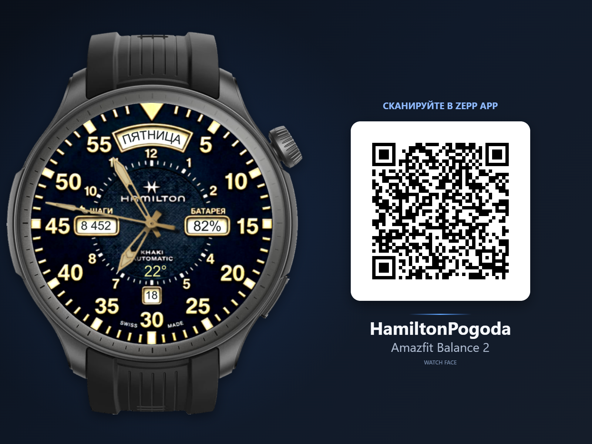
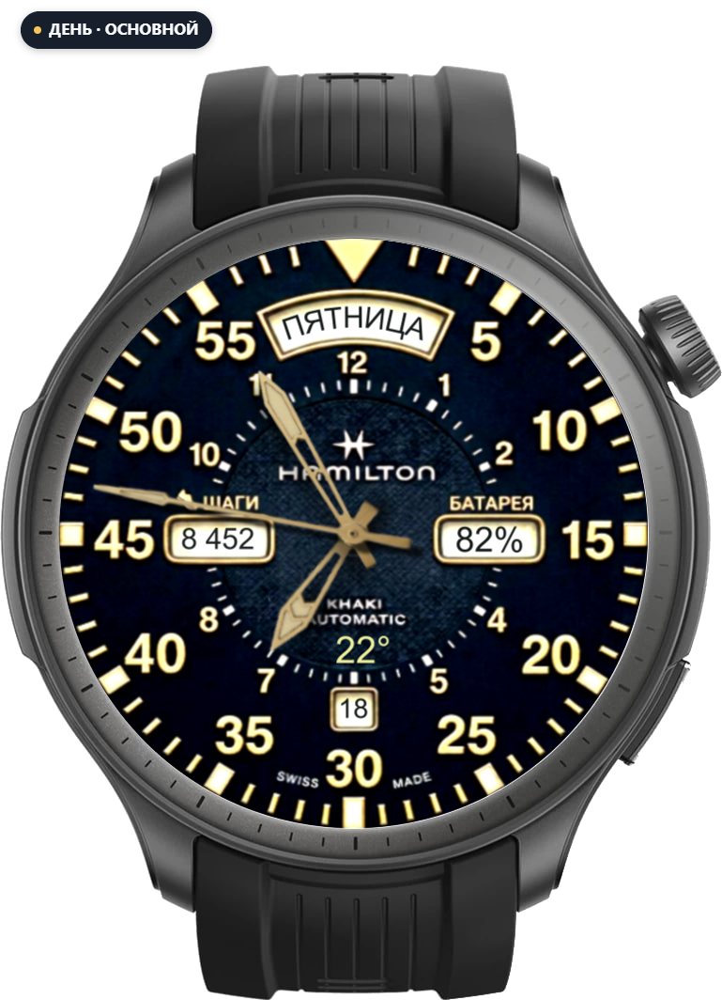
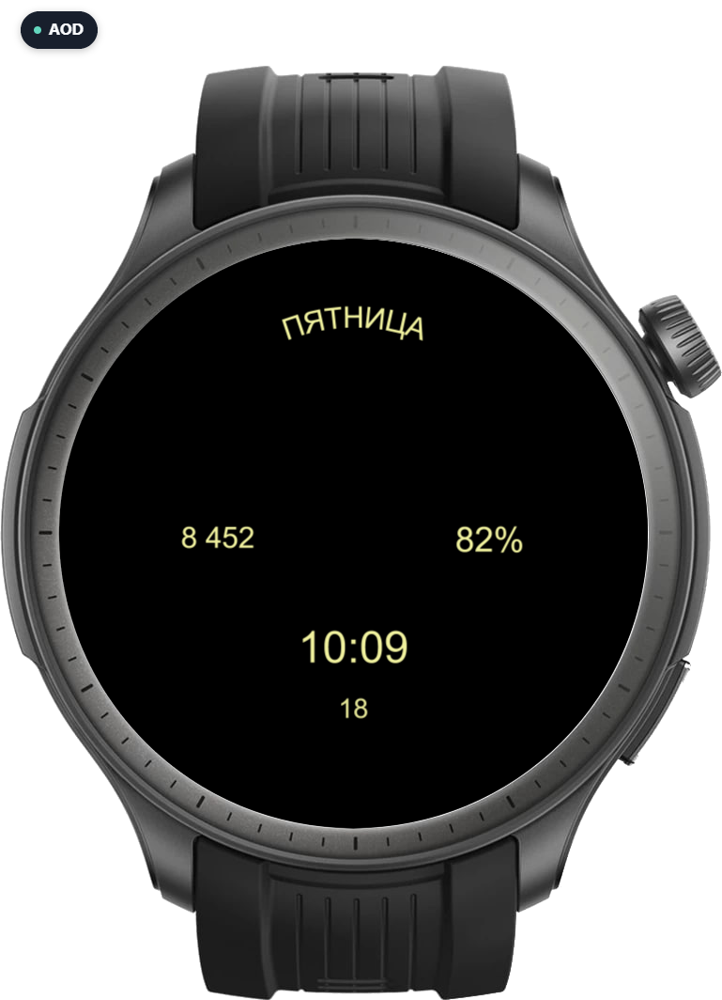

# HamiltonPogoda

Циферблат для Amazfit Balance 2 (Zepp OS), создан в редакторе AmazFace.

## Превью циферблата

| Дневной · основной | AOD |
| :--: | :--: |
|  |  |

- **Версия:** 1.1.1
- **Опубликовано:** 2026-11-12T17:46:05.271Z
- **Установочный пакет:** [HamiltonPogoda.zpk](https://raw.githubusercontent.com/s7018025085/watchfaces/main/Balance2/HamiltonPogoda/HamiltonPogoda.zpk)
- **Ссылка для QR (zpkd1://):** `zpkd1://raw.githubusercontent.com/s7018025085/watchfaces/main/Balance2/HamiltonPogoda/HamiltonPogoda.zpk`

## Установка

1. Включите режим разработчика в Zepp App: Профиль → Настройки → О программе → семь раз нажмите на значок Zepp.
2. Профиль → ваши часы → «Режим разработчика» → «Сканировать» (часы должны быть подключены).
3. Отсканируйте QR-код циферблата. Ссылка на пакет постоянная: при обновлении циферблата тот же QR ставит актуальную версию (GitHub CDN может отдавать прежнюю версию до 5 минут).

## Файлы

- `HamiltonPogoda.zpk` — установочный пакет
- `device.zip` — содержимое для устройства (то же, что внутри пакета)
- `project.zip` — полный проект Zepp OS
- `HamiltonPogoda-watch.png` — дневной, основной циферблат в полном качестве
- `HamiltonPogoda-aod.png` — превью AOD в полном качестве
- `HamiltonPogoda-watch-200.png` — уменьшенный дневной мокап высотой 200 px
- `HamiltonPogoda-watch-qr.png` — мокап часов с циферблатом и QR-кодом
- `HamiltonPogoda.watchface.json` — исходник циферблата для редактора AmazFace («Открыть»)
- `amazface-publish.json` — служебный файл AmazFace: защищает папку от случайной перезаписи другим проектом
