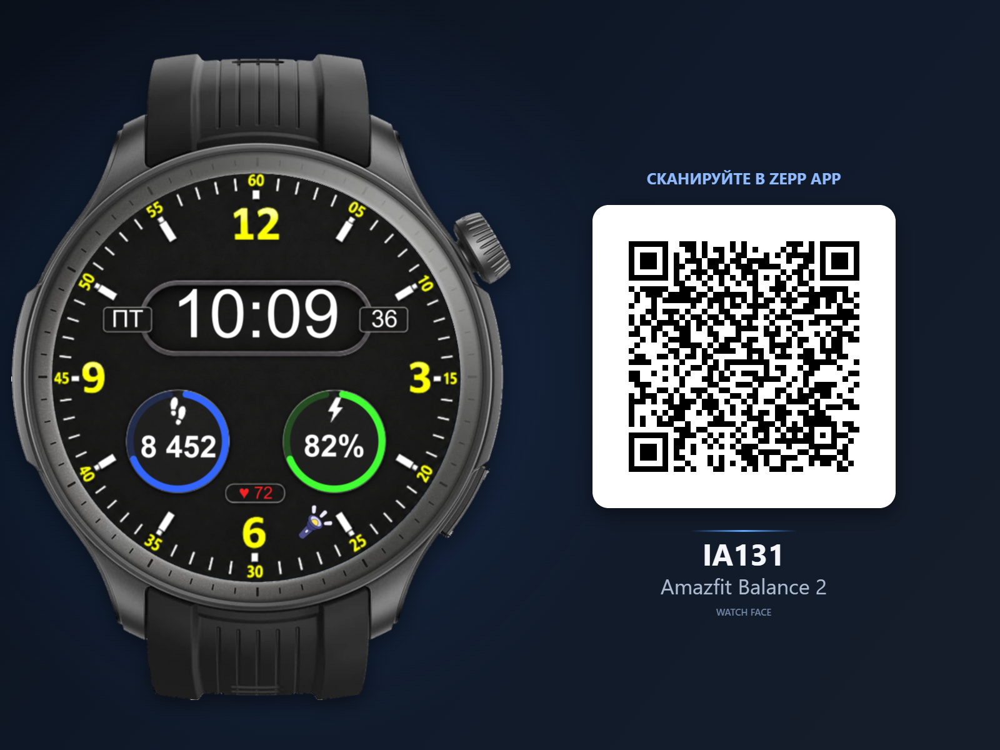

# IA131

Циферблат для Amazfit Balance 2 (Zepp OS), создан в редакторе AmazFace.

- **Версия:** 1.0.0
- **Опубликовано:** 2026-10-30T13:41:49.253Z
- **Установочный пакет:** [IA131.zpk](https://raw.githubusercontent.com/s7018025085/watchfaces/main/Balance2/IA131/IA131.zpk)
- **Ссылка для QR (zpkd1://):** `zpkd1://raw.githubusercontent.com/s7018025085/watchfaces/main/Balance2/IA131/IA131.zpk`

## Установка

1. Включите режим разработчика в Zepp App: Профиль → Настройки → О программе → семь раз нажмите на значок Zepp.
2. Профиль → ваши часы → «Режим разработчика» → «Сканировать» (часы должны быть подключены).
3. Отсканируйте QR-код циферблата. Ссылка на пакет постоянная: при обновлении циферблата тот же QR ставит актуальную версию (GitHub CDN может отдавать прежнюю версию до 5 минут).

## Файлы

- `IA131.zpk` — установочный пакет
- `device.zip` — содержимое для устройства (то же, что внутри пакета)
- `project.zip` — полный проект Zepp OS
- `IA131-watch.png` — мокап часов в полном качестве
- `IA131-watch-200.png` — мокап часов высотой 200 px
- `IA131-watch-qr.png` — мокап часов с циферблатом и QR-кодом
- `IA131.watchface.json` — исходник циферблата для редактора AmazFace («Открыть»)
- `amazface-publish.json` — служебный файл AmazFace: защищает папку от случайной перезаписи другим проектом
