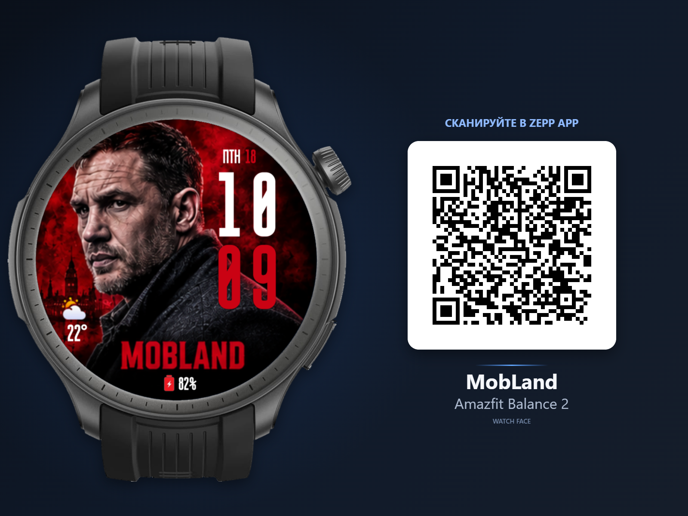
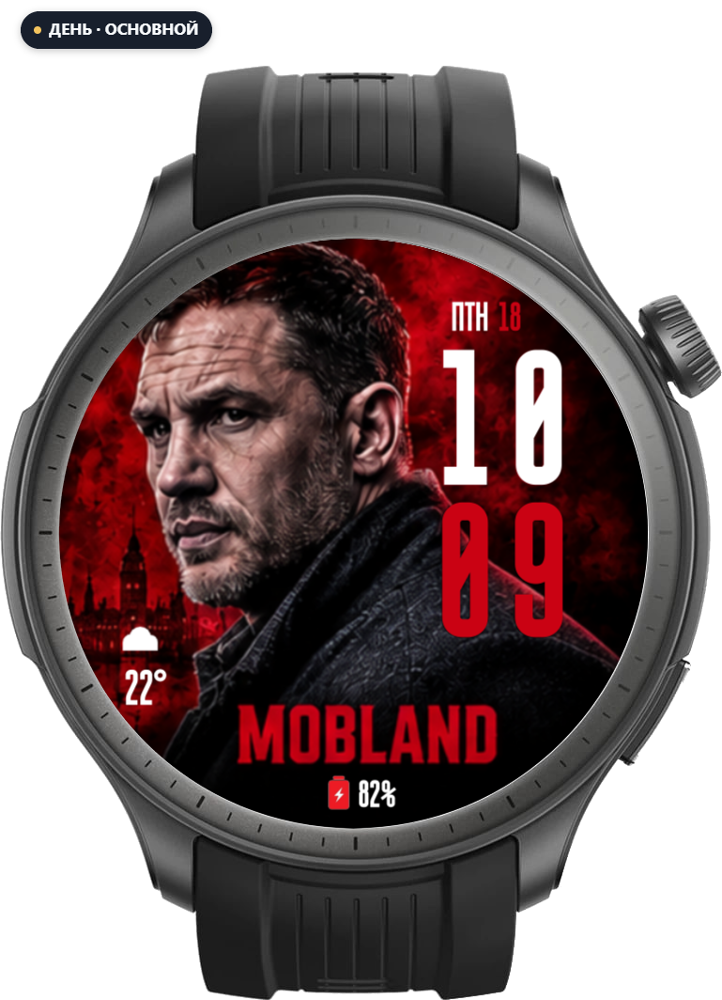
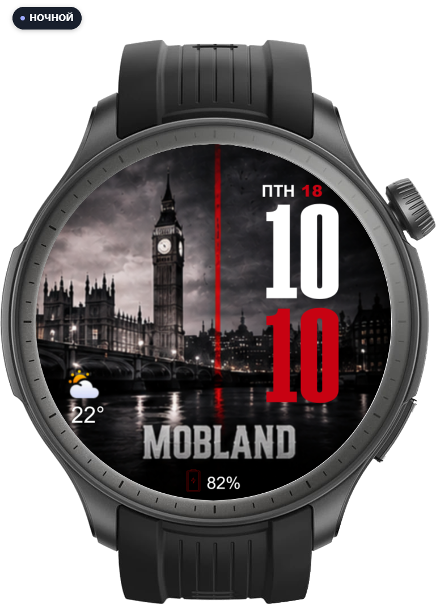
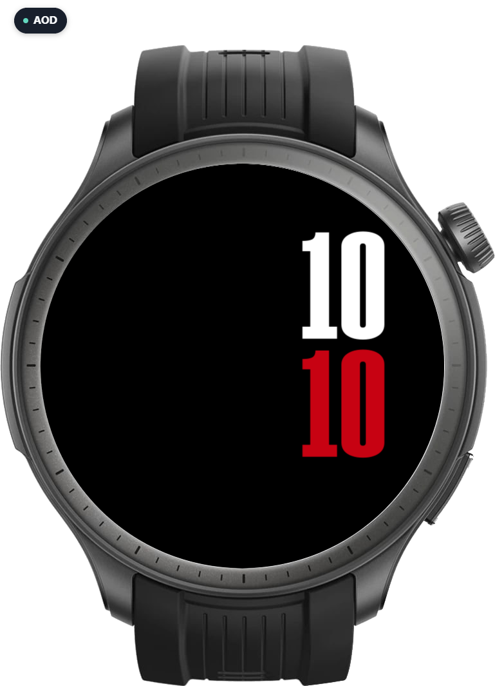
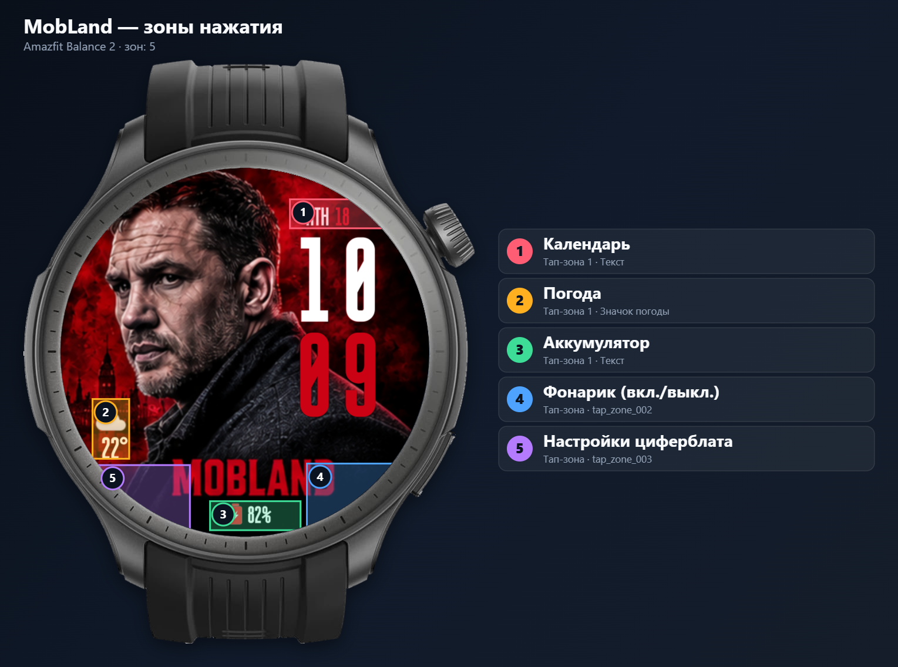

# MobLand

Циферблат для Amazfit Balance 2 (Zepp OS), создан в редакторе AmazFace.

## Превью циферблата

| Дневной · основной | Ночной | AOD |
| :--: | :--: | :--: |
|  |  |  |

## Зоны нажатия

Номера на циферблате соответствуют списку справа: там указано, что открывается по нажатию.

- **Версия:** 1.0.0
- **Опубликовано:** 2026-11-22T17:58:07.746Z
- **Установочный пакет:** [MobLand.zpk](https://raw.githubusercontent.com/s7018025085/watchfaces/main/Balance2/MobLand/MobLand.zpk)
- **Ссылка для QR (zpkd1://):** `zpkd1://raw.githubusercontent.com/s7018025085/watchfaces/main/Balance2/MobLand/MobLand.zpk`

## Установка

1. Включите режим разработчика в Zepp App: Профиль → Настройки → О программе → семь раз нажмите на значок Zepp.
2. Профиль → ваши часы → «Режим разработчика» → «Сканировать» (часы должны быть подключены).
3. Отсканируйте QR-код циферблата. Ссылка на пакет постоянная: при обновлении циферблата тот же QR ставит актуальную версию (GitHub CDN может отдавать прежнюю версию до 5 минут).

## Файлы

- `MobLand.zpk` — установочный пакет
- `device.zip` — содержимое для устройства (то же, что внутри пакета)
- `project.zip` — полный проект Zepp OS
- `MobLand-watch.png` — дневной, основной циферблат в полном качестве
- `MobLand-night.png` — ночной циферблат в полном качестве
- `MobLand-aod.png` — превью AOD в полном качестве
- `MobLand-watch-200.png` — уменьшенный дневной мокап высотой 200 px
- `MobLand-watch-qr.png` — мокап часов с циферблатом и QR-кодом
- `MobLand-tap-zones.png` — карта зон нажатия: что открывается по тапу
- `MobLand.watchface.json` — исходник циферблата для редактора AmazFace («Открыть»)
- `amazface-publish.json` — служебный файл AmazFace: защищает папку от случайной перезаписи другим проектом
